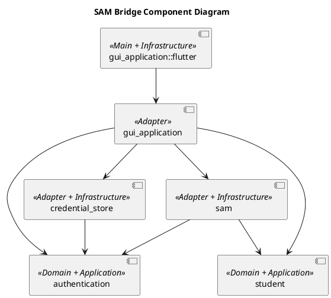
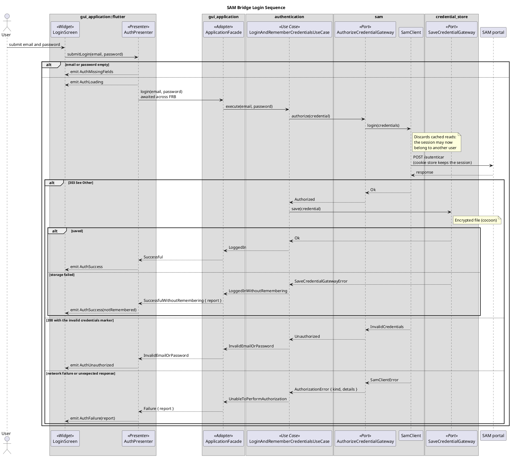
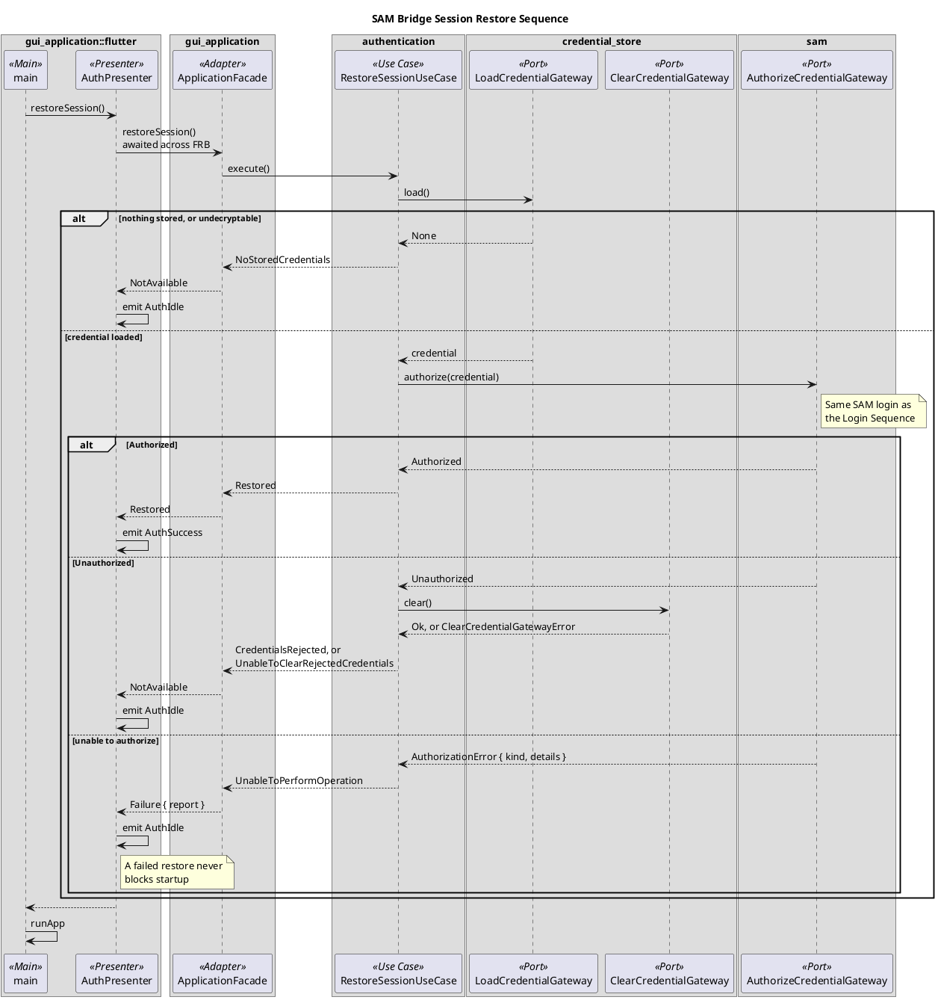

# SAM Bridge

A cross-platform application built with Flutter and Rust that bridges the SAM
(Sistema de Administração Musical) portal. Flutter Rust Bridge (FRB) offloads
stateful HTTP sessions, HTML parsing, and business orchestration to Rust,
while the Flutter side stays a thin presentation layer.

## Architecture

The project follows Test-Driven Development and applies concepts of Clean
Architecture (organized as Vertical Slices) and Domain-Driven Design.

Dependencies point inward: presentation → application → domain.
Infrastructure implements core-defined gateway ports; the core never knows
about HTTP or HTML.



`ui` is the true composition root (`main.dart` calls `RustLib.init()`, builds the
facade, and wires the widget tree), so it owns `<<Main>>`; `gui_application`
exposes an `ApplicationFacade` that translates use cases into FRB-friendly
DTOs, making it an `<<Adapter>>` for the delivery mechanism rather than the
outermost layer. `sam` and `credential_store` implement gateway/store ports
declared by `authentication` and `student` (dependency inversion), which is
why the arrows point from adapter to domain and never the reverse.

### Authentication flows

Each port appears in the lane of the crate that implements it; the trait itself
is declared by `authentication`. Errors travel as `{ kind, details }` up to
`ApplicationFacade`, which turns them into an `ErrorReportDto`.

Logging in authorizes the credential against SAM and only then remembers it.
Failing to remember it still logs the user in.



At startup, `main.dart` restores the session before running the app. Credentials
that SAM rejects are cleared, and no failure here keeps the user from reaching
the login form.



## Development

Common commands (from the repository root unless noted):

```sh
# Rust
cargo test --workspace
cargo clippy --workspace --all-targets
cargo llvm-cov nextest --workspace --summary-only --ignore-filename-regex 'frb_generated\.rs|/tests/support/'

# Flutter (inside gui_application/flutter)
flutter pub get
flutter analyze
flutter test
flutter run linux
flutter build linux --debug     # rm -rf build/linux if CMake cache goes stale

# Both stacks (repository root): combined line-coverage percentage
scripts/coverage.sh

# Regenerate FRB bindings after changing anything under gui_application/src/api/
cd gui_application/flutter && flutter_rust_bridge_codegen generate
```

## Localization

The UI speaks Brazilian Portuguese and English, chosen from the OS language:
any Portuguese locale gets Portuguese, everything else gets English.
Translations live in `gui_application/flutter/lib/l10n/app_<language>.arb`,
with `app_pt.arb` as the template. Mappers hand widgets enums and dates, and
widgets turn them into text through `context.l10n`.

To add or change a message, edit every ARB file (a test checks they share the
same keys) and regenerate the committed bindings:

```sh
cd gui_application/flutter && flutter gen-l10n
```

To add a language, add `app_<language>.arb`. When the OS language is not
supported, Flutter falls back to the first entry of the generated
`supportedLocales`, which gen-l10n sorts alphabetically, so a new language
sorting before `en` must come with a `localeResolutionCallback` to keep English
as the fallback.
